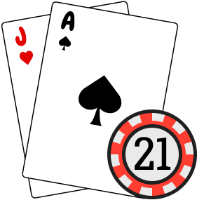

<p align="center">
  
</p>

<h1 align="center">Blackjack</h1>

<p align="center">
  A browser-based Blackjack demo built with Vue 3 and TypeScript.
</p>

<p align="center">
  <a href="https://darwinbecker.github.io/blackjack/">
    <strong>Play Blackjack</strong>
  </a>
</p>

## 📖 Overview

This project is a small implementation of the classic Blackjack card game. It provides a simple, interactive experience where players can play against the dealer using the two fundamental actions: Hit and Stand.

The application focuses on a clean user interface, custom-designed playing cards, and a component-based architecture.

## ✨ Features

- **Interactive Gameplay** – Play Blackjack using Hit and Stand actions.
- **Custom Card Design** – Playing cards designed specifically for this project.
- **Game State Management** – Centralized state management using Pinia.

## 🛠️ Tech Stack

- **Vue 3**
- **TypeScript**
- **Pinia**
- **Vite**
- GitHub Pages

## 🚀 Getting Started

### 📋 Prerequisites

- Node.js
- npm

### 📦 Installation

Clone the repository:

```bash
git clone https://github.com/darwinbecker/blackjack.git
cd blackjack
```

Install dependencies:

```bash
npm install
```

### 💻 Development

Start the local development server:

```bash
npm run dev
```

### 🏗️ Production Build

Build the application for production:

```bash
npm run build
```

## 🌐 Deployment

The application is hosted on **GitHub Pages**.
